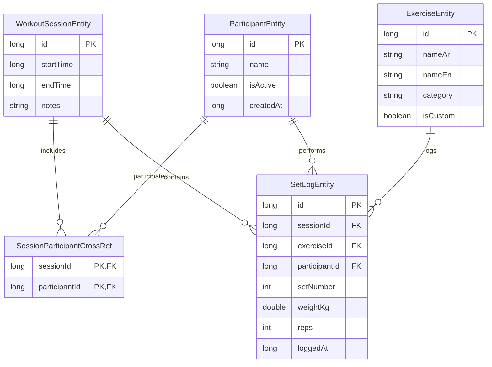

# Architectural Plan: SPEC-001 Gym Workout Logging

- **Spec Reference**: [docs/ai-sdlc/specs/SPEC-001.md](file:///e:/AI%20Projects/GYM%20Tracker%20App/docs/ai-sdlc/specs/SPEC-001.md)
- **Role**: Software Architect
- **Status**: draft

---

## 1. Overview & Architectural Goals
Implement an offline-first Android application in Kotlin using Jetpack Compose (Material 3), Room Database, and MVVM (`ViewModel` + `StateFlow`). The application facilitates group gym tracking (2–3 participants) on a single shared device, logging rounds, weights in KG, and reps with quick adjustment controls, session persistence, and history review.

---

## 2. Room Entities & Relations

---

## 3. Files to Create

### Architecture & Data Layer
1. `app/src/main/java/com/gymtracker/app/data/local/AppDatabase.kt`
2. `app/src/main/java/com/gymtracker/app/data/local/entity/ParticipantEntity.kt`
3. `app/src/main/java/com/gymtracker/app/data/local/entity/ExerciseEntity.kt`
4. `app/src/main/java/com/gymtracker/app/data/local/entity/WorkoutSessionEntity.kt`
5. `app/src/main/java/com/gymtracker/app/data/local/entity/SessionParticipantCrossRef.kt`
6. `app/src/main/java/com/gymtracker/app/data/local/entity/SetLogEntity.kt`
7. `app/src/main/java/com/gymtracker/app/data/local/dao/ParticipantDao.kt`
8. `app/src/main/java/com/gymtracker/app/data/local/dao/ExerciseDao.kt`
9. `app/src/main/java/com/gymtracker/app/data/local/dao/WorkoutDao.kt`
10. `app/src/main/java/com/gymtracker/app/data/repository/GymRepository.kt`
11. `app/src/main/java/com/gymtracker/app/data/repository/GymRepositoryImpl.kt`

### UI Layer (Compose & ViewModels)
12. `app/src/main/java/com/gymtracker/app/ui/participants/ParticipantsViewModel.kt`
13. `app/src/main/java/com/gymtracker/app/ui/participants/ParticipantsScreen.kt`
14. `app/src/main/java/com/gymtracker/app/ui/exercises/ExercisesViewModel.kt`
15. `app/src/main/java/com/gymtracker/app/ui/exercises/ExercisesScreen.kt`
16. `app/src/main/java/com/gymtracker/app/ui/session/ActiveSessionViewModel.kt`
17. `app/src/main/java/com/gymtracker/app/ui/session/ActiveSessionScreen.kt`
18. `app/src/main/java/com/gymtracker/app/ui/history/HistoryViewModel.kt`
19. `app/src/main/java/com/gymtracker/app/ui/history/HistoryScreen.kt`
20. `app/src/main/java/com/gymtracker/app/ui/theme/Theme.kt`

### Test Suite
21. `app/src/test/java/com/gymtracker/app/data/local/ParticipantDaoTest.kt`
22. `app/src/test/java/com/gymtracker/app/data/local/ExerciseDaoTest.kt`
23. `app/src/test/java/com/gymtracker/app/data/local/WorkoutDaoTest.kt`
24. `app/src/test/java/com/gymtracker/app/data/repository/GymRepositoryTest.kt`
25. `app/src/test/java/com/gymtracker/app/ui/session/ActiveSessionViewModelTest.kt`

---

## 4. Test List Mapped to Acceptance Criteria

| Acceptance Criterion | Planned Automated Test Method | Test Scope |
| :--- | :--- | :--- |
| **AC-1** Initial Participant Setup | `ParticipantDaoTest.testInitialParticipantSetup_savesActiveParticipants()` | Verify initial participants saved with `isActive = true`. |
| **AC-2** Participant Name Persistence | `GymRepositoryTest.testParticipantPersistence_reloadsOnRestart()` | Verify participants reloaded across instances. |
| **AC-3** Custom Exercise Creation | `ExerciseDaoTest.testCustomExerciseCreation_savesWithIsCustomTrue()` | Verify insertion of custom exercise with flag. |
| **AC-4** Session Initialization | `WorkoutDaoTest.testWorkoutSessionInit_createsSessionWithSelectedParticipants()` | Verify session created with selected participant cross-refs. |
| **AC-5** Set Logging with KG & Reps | `WorkoutDaoTest.testSetLogging_savesSetLogWithKgAndReps()` | Verify exact `weightKg` and `reps` storage. |
| **AC-6** Fast Step Controls | `ActiveSessionViewModelTest.testFastStepControls_incrementsWeightAndRepsCorrectly()` | Verify state increments: `+2.5`/`+5.0` kg and `+1` reps. |
| **AC-7** Previous Set Pre-fill | `ActiveSessionViewModelTest.testPreviousSetPrefill_defaultsToLastSetValues()` | Verify subsequent rounds auto-fill from previous round. |
| **AC-8** Historical Performance Lookup | `GymRepositoryTest.testHistoricalLookup_returnsPreviousSessionStats()` | Verify previous session reference query. |
| **AC-9** Session Completion | `WorkoutDaoTest.testSessionCompletion_updatesEndTime()` | Verify `endTime` timestamp set on finish. |
| **AC-10** Input Validation (Weight/Reps) | `GymRepositoryTest.testInputValidation_rejectsNegativeWeightAndNonPositiveReps()` | Verify rejection/clamping of invalid numbers. |
| **AC-11** Input Validation (Names) | `GymRepositoryTest.testInputValidation_rejectsBlankParticipantAndExerciseNames()` | Verify error on blank or whitespace-only names. |
| **AC-12** Soft Deletion of Participant | `ParticipantDaoTest.testSoftDelete_setsIsActiveFalseAndPreservesSetLogs()` | Verify `isActive = false` and preserved historical logs. |
| **AC-13** In-Session Set Edit/Delete | `WorkoutDaoTest.testSetModificationAndDeletion_updatesDbAndReindexes()` | Verify set edit and set removal with set number re-indexing. |
| **AC-14** Active Session Recovery | `ActiveSessionViewModelTest.testActiveSessionRecovery_restoresUnfinishedSession()` | Verify unclosed session state restoration on app launch. |

---

## 5. Technical Risks & Mitigation
1. **Risk: Process Death Mid-Session**: Mitigated by committing every set directly to Room SQLite upon tap.
2. **Risk: Data Corruption on Participant Removal**: Mitigated by soft-deletion (`isActive = false`) preserving foreign key references.
3. **Risk: UI Thread Stutter on Number Stepper**: Mitigated by immutable Kotlin state data classes and coroutines on `Dispatchers.IO`.

---

## 6. Rollback Note
Revert Git commits to return to clean state. Room schema uses `fallbackToDestructiveMigration()` during initial development.

---
Status: draft
